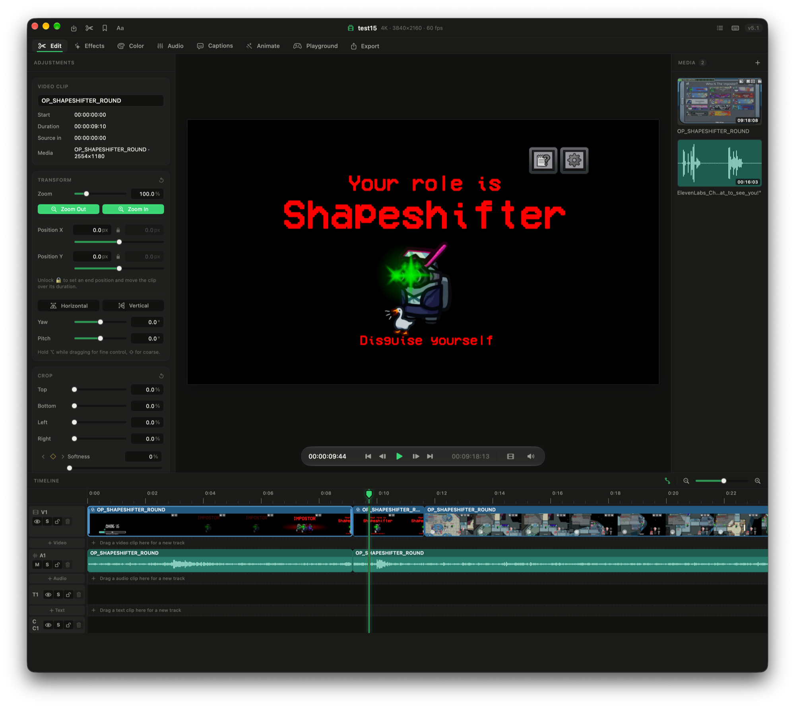
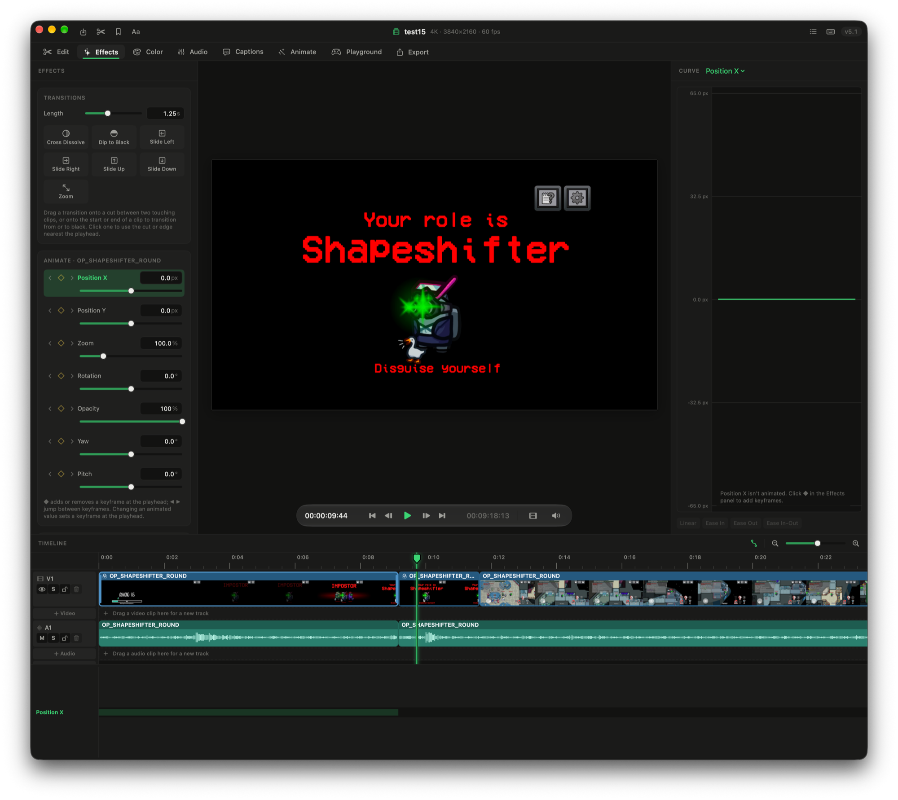
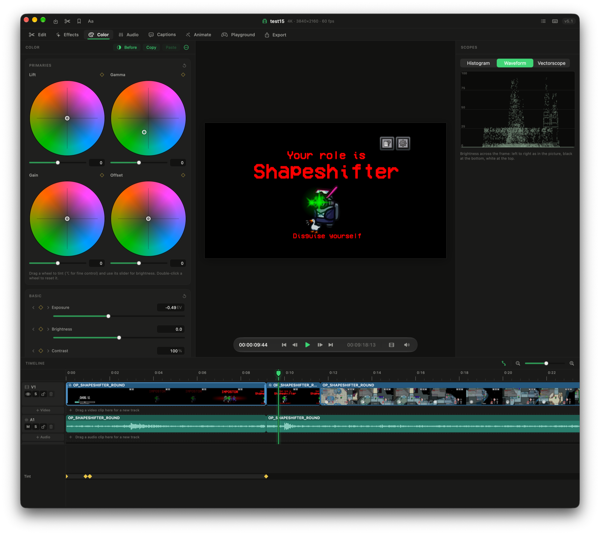
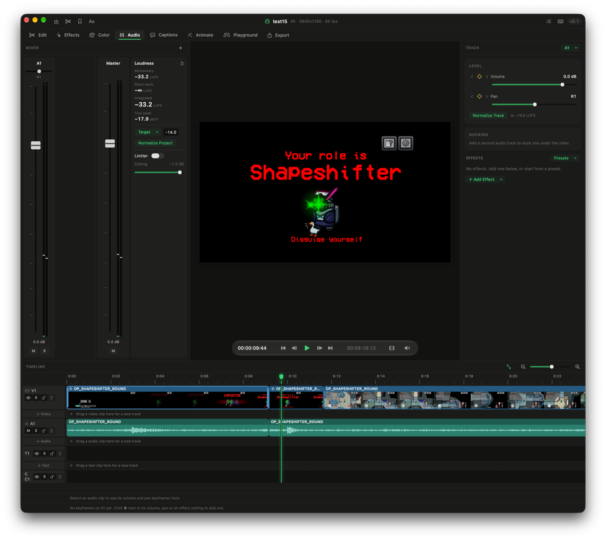
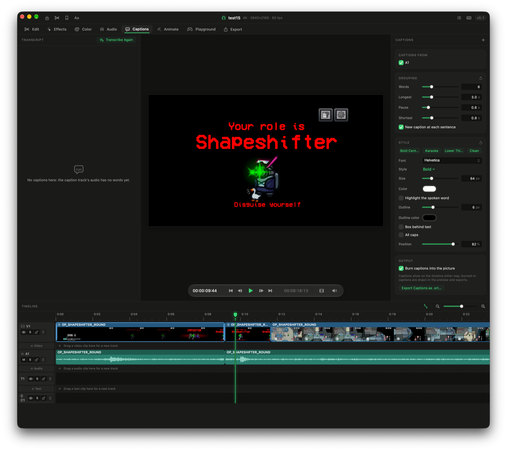
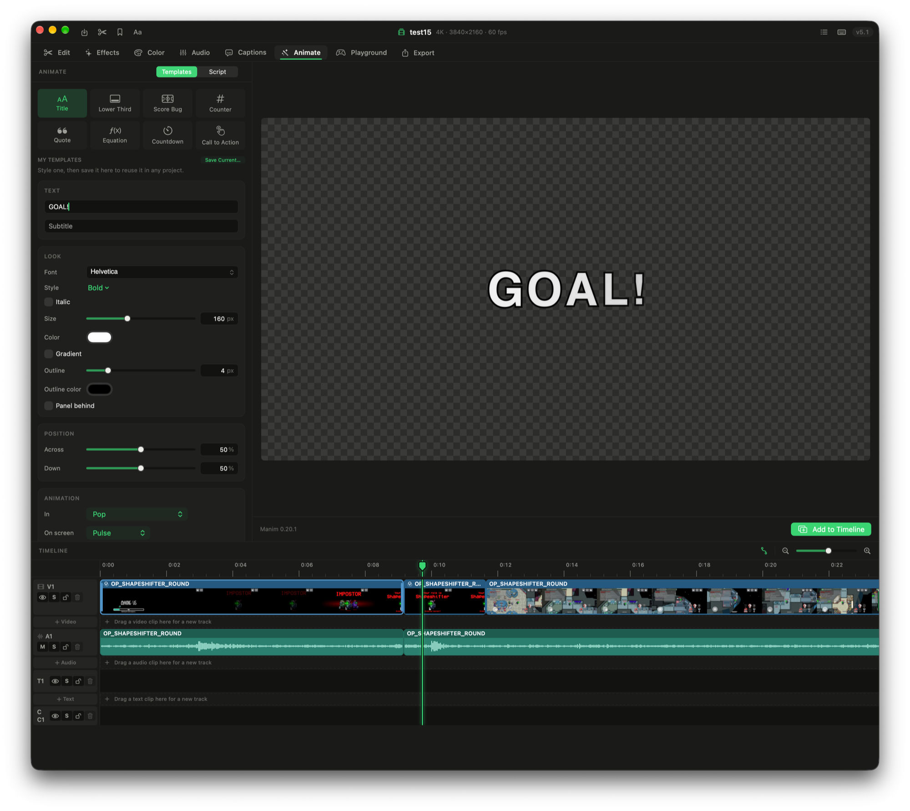
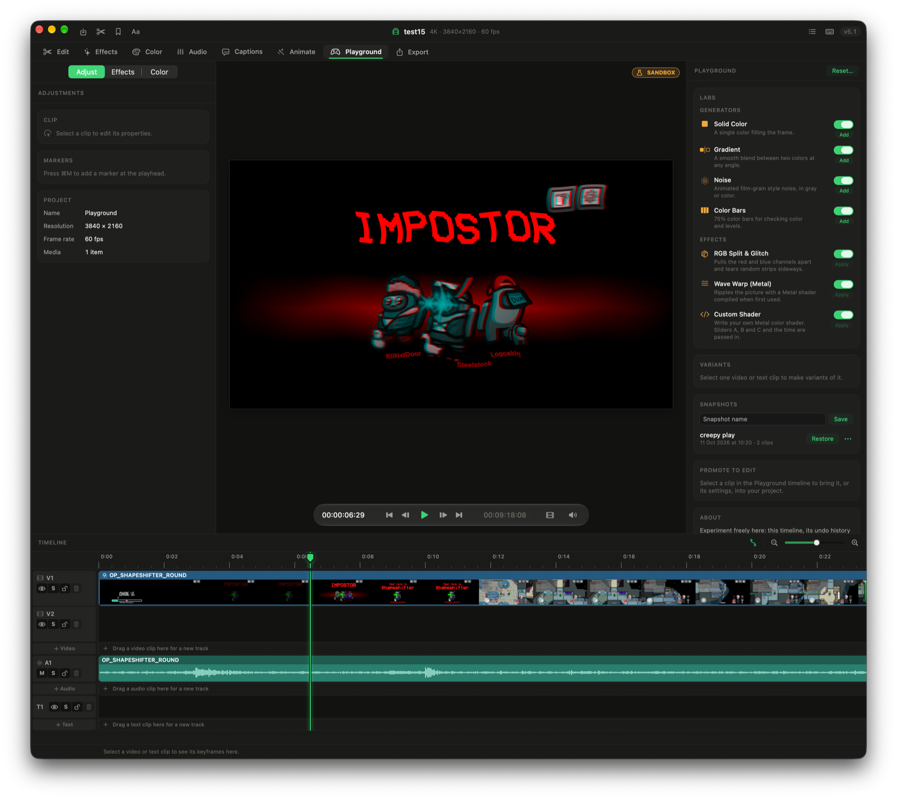
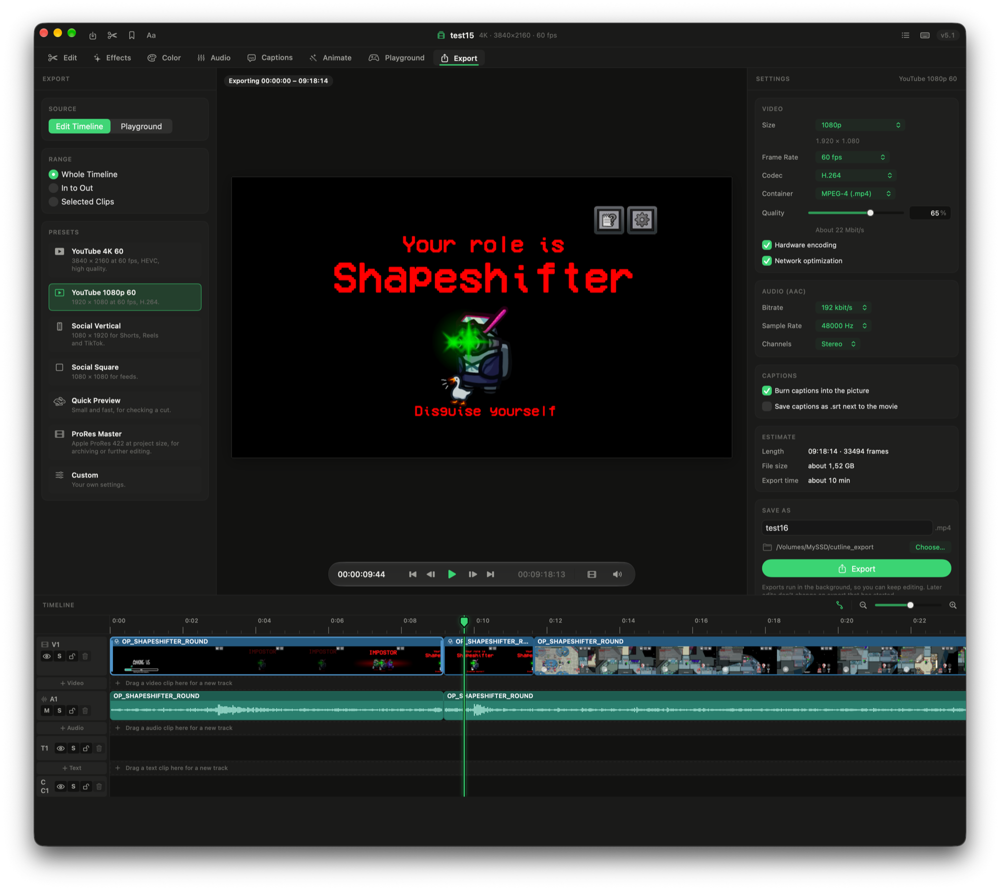
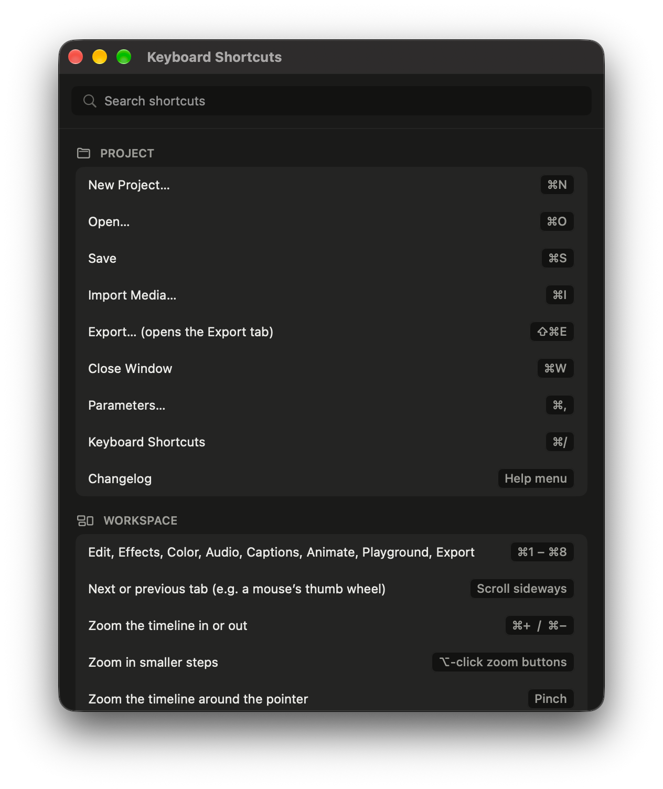
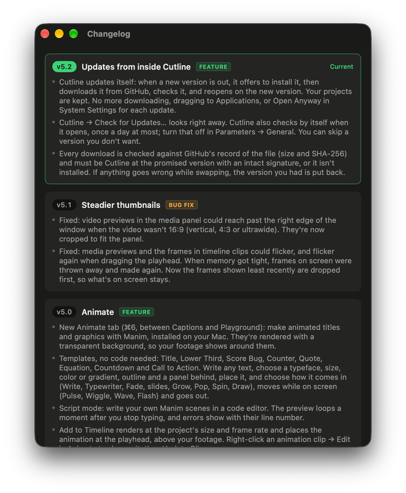

# Cutline

A native video editor for macOS, written in Swift and SwiftUI with no third-party dependencies.



## Download

Get the newest version from **[Releases](https://github.com/jt2qrtp29t-netizen/Cutline/releases/latest)**: open **Cutline-X.Y.dmg** and drag Cutline onto Applications. It needs macOS 27 on a Mac with Apple silicon.

Cutline isn't notarized by Apple, so the first time you open it macOS blocks it: click **Done**, then go to **System Settings → Privacy & Security** and click **Open Anyway**. After that, Cutline updates itself (**Cutline → Check for Updates…**), with no more Open Anyway.

## What it does

Cutline is organized into tabs (⌘1–⌘8):

- **Edit**: a multi-track timeline with trimming, linking, locking, keyframes, speed changes and speed ramps (with frame blending and pitch-kept or tape-style audio), crop and transforms, and optimized and proxy media.
- **Effects**: animate any clip parameter with keyframes, and transitions between clips.
- **Color**: color wheels, curves, LUTs and scopes.
- **Audio**: a mixer, loudness metering, fades, pitch and ducking, with smooth, click-free scrubbing.
- **Captions**: on-device transcription (Apple's Speech framework) with word timing, editable transcripts, styled burned-in captions and `.srt` export.
- **Animate**: animated titles and graphics made with [Manim](https://www.manim.community), either from no-code templates (titles, lower thirds, score bugs, counters, countdowns and more) or from your own Python scripts. They're rendered with a transparent background over your footage.
- **Playground**: a sandbox copy of your edit for trying ideas without touching the real project.
- **Export**: H.264, HEVC and ProRes 422 exports, plus **Make Thumbnail**, which picks the best frames with Apple's Vision framework and, optionally, a local AI model through [Ollama](https://ollama.com). Nothing leaves your Mac.

## Screenshots

| | |
|---|---|
|  **Effects**: transitions and keyframes |  **Color**: wheels, curves and scopes |
|  **Audio**: mixer and loudness |  **Captions**: transcripts and styled captions |
|  **Animate**: Manim templates and scripts |  **Playground**: a sandbox for ideas |
|  **Export**: presets and settings |  **Keyboard Shortcuts** |
|  **Changelog**: what changed in each version | |

## Requirements

- macOS 27 or later
- Xcode with the macOS 27 SDK (Swift 6)

Optional tools, run as separate programs on your Mac and only needed for their features:

- **Manim** for the Animate tab: `brew install cairo pango ffmpeg`, then `pip3 install manim`. LaTeX (for example MacTeX) is needed for the Equation template only.
- **Ollama** with a vision model (such as `ollama pull qwen2.5vl:3b`) for AI thumbnail picks.

## Building

```sh
git clone <this repository>
cd Cutline
open Cutline.xcodeproj
```

Then build and run the **Cutline** scheme in Xcode. From the command line:

```sh
xcodebuild -project Cutline.xcodeproj -scheme Cutline build
xcodebuild -project Cutline.xcodeproj -scheme Cutline test
```

Tests that need Manim or Ollama skip themselves when those tools aren't installed.

## License

Cutline is free software, released under the [GNU General Public License v3.0](LICENSE). You can use, study, change and share it. If you distribute a changed version, it must also be released under the GPL with its source code.
